# aBaja 2026 Lane Keeping Assist (LKA) — how it works

This document explains the LKA in `models/LKA_Controller.slx`. The LKA takes the
output of a lane detector and turns it into a **turning radius** for the vehicle,
and from that into a road-wheel steering angle.

Every number quoted here comes from `src/utilities/lka_build_params.m`.

---

## 1. Conventions

| Item | Convention |
|---|---|
| Frame | ISO 8855 vehicle frame: x forward, y left, yaw counter-clockwise positive |
| Lane reference point | Rear-axle centre. This is the point a bicycle model turns about, so `R = 1/κ` is exact there |
| Signs | Positive curvature, steering angle or turning radius means turning **left** |
| Units | SI and radians inside the LKA. Converted to degrees only at the interface to `aBaja2026.slx` |
| Rate | Everything runs at `LKA.Ts = 0.05 s` (20 Hz), the same rate as the detector frames and the skeleton step |

---

## 2. Architecture

```
            ┌──────────────────────── LKA_Controller.slx ─────────────────────────────────────────┐
LaneSensor ─►│ Lane Perception ──► LaneEstimate ─┬─► LKA Supervisor (Stateflow) ── Active ──┐   │
 (L+R lines) │  validation, centre fusion,       ├─► Lane Departure Warning (DLC/TLC)       │   │
Speed ──────►│  Kalman tracker, latency comp.    └─► Lateral Controllers                    │   │
YawRate ────►│                                        • Pure Pursuit (+FF, +I)  ┐           ▼   │
Enable ─────►│                                        • Stanley 2025 baseline   ├─► κ_req ──►... │
             │                                        • MPC (QP, preview)       ┘                │
             │   ... ► Curvature Limiter (a_y, jerk) ─► κ_cmd ─► Steering Command δ = atan(κ(L+K_us v²))
             │       ─► Steering Actuator Manager (authority ramp, ±32°, 60°/s, 5 Hz LPF) ─► δ_cmd
             │       ─► Turning Radius  R = 1/κ_out,  κ_out = tan(δ_cmd)/(L + K_us v²)        │
             └──────────────────────────────────────────────────────────────────────────────────┘
Outputs: SteerCmd [rad], TurnRadius [m], LkaInfo (25 signals), LaneEstimate
```

All of the algorithm code lives in `src/`. The Simulink MATLAB Function blocks
call those same files, so the unit tests (`tests/unit_tests/test_lka_core.m`)
test exactly the code the model runs.

### 2.1 Input: the lane detector message (`LaneSensorBus`)

The detector reports each ego-lane boundary (`Left` and `Right`) as a clothoid
in the vehicle frame. This is the same representation Automated Driving Toolbox
uses for lane boundaries:

```
y(x) = LateralOffset + tan(HeadingAngle)·x + Curvature·x²/2 + CurvatureDerivative·x³/6
```

Each boundary also carries a `Strength` (0 means not detected) and a
`ViewRange`. Any lane detector can drive the LKA if it fills this bus:

- the emulated detector (`models/VirtualLaneSensor.slx`)
- a future port of the Asterix sliding-window detector
- a deep-learning detector

The 2025 detectors output pixels or annotated images only. The Asterix detector
outputs metric offset and radius but no heading.

### 2.2 Lane Perception

1. **Boundary validation** (`lka_validate_boundaries.m`). A boundary is used only if:
   - its strength is at least 0.3;
   - it is on its own side of the vehicle, with 0.5 m tolerance so a vehicle touching a line keeps that line;
   - its heading is within 35° and its curvature within 0.1 1/m;
   - its offset has not jumped by more than 0.6 m since the last accepted frame.

   When both boundaries pass, the implied lane width must lie between 2.5 and
   5.0 m. If it doesn't, the weaker boundary is dropped.
2. **Lane width estimator.** A first-order filter with τ = 2 s. It updates only
   while both lines are valid.
3. **Lane-centre fusion** (`lka_estimate_lane_center.m`):
   - Each boundary is moved half a lane width towards the centre, along the
     lane normal, and its curvature is converted to the centreline radius:
     `κc = κL/(1+κL·w/2)` or `κR/(1−κR·w/2)`.
   - The two estimates are averaged, weighted by detection strength, as in the
     MathWorks "Estimate Lane Center" reference design.
   - If only one line is seen, the centre is still produced but its measurement
     noise is doubled.
4. **Lane state tracker** (`lka_lane_tracker_step.m`) is a Kalman filter on
   `x = [y, ψ, κ, κ']`, the lane centre as seen from the rear axle. Its motion
   model is exact for a rear axle with no side-slip:
   ```
   ẏ = v·ψ      ψ̇ = v·κ − r      κ̇ = v·κ'      κ̇' = noise
   ```
   - The measured yaw rate `r` is the input, so the filter dead-reckons the lane
     through detector dropouts.
   - Outliers are rejected with a χ² gate on offset and heading. After 4
     consecutive rejections the filter re-initialises.
   - Curvature is not gated, because arcs in the official track join without
     transition spirals.
   - It outputs a quality value of `1 − σ_y/0.4 m`.
5. **Latency compensation** (`lka_lane_predict.m`). Detector frames are 50 ms
   old. The estimate is predicted forward by that latency with the same motion
   model (ego-motion compensation).

### 2.3 LKA Supervisor (Stateflow `LKA Mode Logic`)

| State | Steering authority | Entered when |
|---|---|---|
| OFF | none | `enable` false |
| STANDBY | none | enabled, but speed or lane not OK |
| ACTIVE | yes | speed within 0.5–12 m/s (hysteresis 0.2), lane quality ≥ 0.6 (hysteresis 0.3), last detector measurement ≤ 0.25 s old, and road curvature within steering capability |
| DEGRADED | yes, on the tracker's prediction | the lane is lost while ACTIVE: no measurement for more than 0.25 s (5 frames), or quality too low |
| TAKEOVER | none, take-over request | the lane has been lost for more than 1.0 s. Returns to STANDBY after 2 s once the lane is back |

The activation conditions are Simulink blocks: Relay blocks for the hysteresis
and Compare blocks for the limits. The chart only sequences the modes.

### 2.4 Lane Departure Warning

`lka_lane_departure.m` evaluates both axles. It compares the outer edge of each
tyre with the inner edge of the painted line. This is the rulebook criterion
(K.2.4): a wheel touching the line counts as outside the lane. From this it
gives:
- distance to line crossing (DLC);
- time to line crossing (TLC), using the lateral rate of the lane centre at the axle, `v·ψ + x·(v·κ − r)`.

A warning is raised when DLC < 0.15 m or TLC < 0.8 s. The warning is computed
and logged but does not change the steering.

### 2.5 Lateral controllers: lane estimate → curvature (= 1 / turning radius)

All three controllers run in parallel every step. `LKA.ControllerSelect` picks
which one steers. The others run in shadow mode for comparison.

**1. Pure pursuit with curvature feed-forward (main controller, `lka_pure_pursuit.m`)**

The target point lies on the estimated lane centre, `L_d` ahead of the rear axle:
```
y_T = y + ψ·L_d + κ·L_d²/2 + κ'·L_d³/6
```
The circular arc from the rear axle (tangent to the vehicle heading) through
that point has curvature
```
κ_PP = 2·y_T / (L_d² + y_T²)          turning radius  R = 1/κ_PP
```
For small errors this expands to
```
κ_PP ≈ κ  +  (2/L_d)·ψ  +  (2/L_d²)·y  +  κ'·L_d/3
       │       │             │
       │       │             └ proportional action on lateral offset
       │       └ proportional action on heading (damping)
       └ road-curvature feed-forward (follows the curve with zero error)
```
So pure pursuit on the detected lane is a feed-forward-plus-PD controller, and
both gains come from one physical knob, the look-ahead distance `L_d`:
- `L_d` comes from a 1-D lookup table on speed: 2.5 m at standstill, 6.0 m at 30 km/h, 8.5 m at 50 km/h.
- It is shortened in curves by `L_d/(1 + 1.5·|κ|·L_d)` to limit corner cutting.

A small integral term removes any steady offset that unmodelled understeer
leaves in long curves:
- `κ_I = 0.002·∫y dt`, limited to ±0.004 1/m;
- it runs only while active, not saturated, and above 2 m/s;
- it resets when the LKA is inactive.

**2. Stanley + PID, aBaja 2025 baseline (`lka_stanley_2025.m`)**

This is the 2025 `ros2_ws/.../lka.py` law ported with every gain unchanged:
- `δ = ψ_chord + atan2(0.3·min(2, v/5)·cte, v + 1) + PID(cte)`
- ψ_chord is the heading of the chord to a look-ahead point `6 + 0.4·v` m ahead;
- 0.1 m deadzone; PID gains 0.015 / 0.001 / 0.005, clipped to ±3°;
- ±12° limit, 25°/s rate limit, smoothing factor 0.7.

The one change is the 2025 frame bug: there, world-frame vehicle positions were
compared with vehicle-frame lane points, giving cross-track errors of −249 to
−300 m. The port takes every error from the vehicle-frame lane estimate.

**3. Linear time-varying model predictive control (`lka_mpc_curvature.m`)**

Prediction model, with the speed varying along the horizon:
```
ė_y = v_k·e_ψ      ė_ψ = v_k·(κ_v − κ_road)      κ̇_v = (κ_cmd − κ_v)/τ_steer
```
- The model is discretised exactly (zero-order hold) at every horizon step.
- The predicted speed follows the measured acceleration, `v_k = v + a·k·Ts`.
- 30 steps (1.5 s), with the road-curvature preview taken from the lane clothoid.
- Cost: `Σ 100·e_y² + 1000·e_ψ² + 1000·(κ_cmd − κ_road)² + 5e5·Δκ_cmd²`.
- The constraints are applied per step at that step's speed, and are the same
  envelope the curvature limiter applies: `|κ| ≤ κ_max(v_k)` and
  `|Δκ| ≤ κ̇_max(v_k)·Ts`.
- Solved each step as a quadratic program with `mpcActiveSetSolver`,
  warm-started from the previous active set.
- The state κ_v is the measured path curvature `r/v`. The rate constraint
  starts from the MPC's own previous command, so the MPC stays self-consistent
  in shadow mode and during the authority ramp.

What it took to get here:
- **The MPC Toolbox "Lane Keeping Assist System" block was tried first and
  rejected.** It is tuned for a 1575 kg sedan, has no steering-rate constraint,
  and was unstable against the jerk limit on the 240 kg Baja (lateral errors up
  to 220 m).
- **A constant-speed version of this MPC over-steered during the launch from
  standstill.** It drove the car out of the lane on S3 and S5. The time-varying
  speed profile, the yaw-rate state and the self-referenced rate constraint fixed this.
- **The weights stay stable with up to 200 ms of unmodelled loop delay** in an
  offline closed-loop sweep.

### 2.6 Curvature limiter → steering → actuator manager

1. **Curvature limiter.** Limits the curvature magnitude to
   `κ_max = min(3/v², tan(32°)/(L + K_us·v²))` and the curvature rate to
   `min(5/v², 60°/s / (L + K_us·v²))`. These caps are 3 m/s² lateral
   acceleration and 5 m/s³ lateral jerk, the UNECE R79 ACSF B1 values, plus the
   steering hardware limits.
2. **Steering command.** `δ = atan(κ·(L + K_us·v²))`. This is steady-state
   single-track steering with understeer gradient
   `K_us = m/L·(b/C_f − a/C_r)`, and it reduces to Ackermann `atan(L·κ)` at low
   speed.
3. **Actuator manager**:
   - an authority ramp of 0.5 s on activation and deactivation (bumpless);
   - limits of ±32° and 60°/s (Asterix hardware);
   - a 5 Hz output low-pass filter;
   - a saturation flag that freezes the pure pursuit integrator (anti-windup).
4. **Turning radius output.** `κ_out = tan(δ_cmd)/(L + K_us·v²)` and
   `R = 1/κ_out`, positive to the left. It is clipped to ±1000 m when driving
   straight. This is the radius the vehicle actually drives with the commanded
   steering, after all limits.

---

## 3. Test bench (`models/LKA_MIL_TestBench.slx`)

| Block | Model |
|---|---|
| Scenario | Driver speed profile `v = min(a·t, v_set)` and forced detector outages |
| Steering actuator | 60°/s rate limit, ±32°, 0.1 s first-order lag (the same lag as the skeleton's Delayed Steering System) |
| Vehicle | Nonlinear single-track Baja (`vehicle_params.m`: 240 kg, L = 1.45 m) with saturating tyres `μFz·tanh(Cα/μFz)`, blended to the kinematic model below 3 m/s |
| Lane geometry | The official track read directly from `LKA_IPG.xodr` (`read_xodr_lane.m`: lane 1, 3.5 m, left-hand traffic) |
| Virtual Lane Sensor | 20 Hz frames, 50 ms latency, Gaussian noise (σ: 3 cm, 0.3°, 4e-4 1/m), 1 % random misses per line |
| Ground truth metrics | CG offset, heading error, the four tyre-to-line margins, all-tyres-in-lane flag |

Scenarios (`generate_lka_scenarios.m`):
- **S1:** official track, 0 → 30 km/h at 4 m/s², 60 s.
- **S2:** official track at 33 km/h, the disqualification threshold.
- **S3:** a rulebook-style tight track with the 2025 sample-track radii (R 50 / 60 / 85 m).
- **S4:** degraded detector: 3× noise, 100 ms latency, and outages of 0.6 s on both lines in a curve, 3 s on one line, and 1.5 s on both lines (which triggers a take-over request).
- **S5:** start 0.8 m off-centre with a 4° heading error.

Run it all with:
```matlab
run('config/startup.m')
results = run_lka_mil();                 % 5 scenarios × 3 controllers, figures + KPI table in results/mil
results = run_lka_mil(Scenarios={'S1_Nominal'}, Controllers=1);
```

## 4. Results

See `results/mil/lka_mil_kpis.csv` and the figures in `results/mil/`
(`*_overview.png`, `*_perception.png`, `*_comparison.png`). A summary is in
section 6.

## 5. RoadRunner co-simulation (`aBaja2026.slx`)

`scripts/integrate_lka_into_skeleton.m` adds the root subsystem
"LKA (Lane Keeping Assist)" to the competition model:
- **Inputs:** the vehicle state, the closest route point and the route curvature, taken from `Subsystem2`.
- **Skeleton Pose Adapter:** converts the CG pose in degrees to the rear-axle pose in radians, and derives yaw rate from heading.
- **Emulated detector:** Virtual Lane Sensor.
- **Controller:** LKA_Controller with the `skeleton` profile (L = 3.0 m).
- **Output:** a road-wheel angle in degrees, positive to the left, into `Subsystem2/Controller_SteerCmd`.

That port is the steering source in LKA mode (Mode = 1) and Endurance mode
(Mode = 2). All other modes behave exactly as before.

## 6. Results summary (MIL, Baja profile, 2026-10-16)

Columns:
- **max |e|:** largest lateral offset of the CG from the lane centre.
- **min margin:** smallest distance from any tyre's outer edge to the inner edge of the line.
- **in lane:** share of time with all four tyres inside the lane lines.
- **jerk:** maximum 0.5 s moving-average lateral jerk.

| Scenario | Controller | max \|e\| [m] | RMS [m] | min margin [m] | in lane | max a_y [m/s²] | jerk [m/s³] |
|---|---|---|---|---|---|---|---|
| S1 official track, 30 km/h | **Pure Pursuit** | **0.098** | 0.023 | 0.83 | 100 % | 1.17 | 2.70 |
| | MPC | 0.101 | 0.025 | 0.83 | 100 % | 1.09 | 2.54 |
| | Stanley 2025 | 1.348 | 0.515 | −0.43 | 95.6 % | 2.99 | 5.00 |
| S2 official track, 33 km/h | **Pure Pursuit** | **0.154** | 0.030 | 0.77 | 100 % | 1.68 | 3.57 |
| | MPC | 0.158 | 0.033 | 0.77 | 100 % | 1.57 | 3.34 |
| | Stanley 2025 | 1.395 | 0.652 | −0.47 | 78.1 % | 2.99 | 5.00 |
| S3 tight R 50/60/85 m | **Pure Pursuit** | **0.393** | 0.101 | 0.53 | 100 % | 2.94 | 4.90 |
| | MPC | 0.315 | 0.099 | 0.60 | 100 % | 2.65 | 4.42 |
| | Stanley 2025 | 2.114 | 0.882 | −1.20 | 73.0 % | 2.99 | 5.00 |
| S4 degraded detector¹ | **Pure Pursuit** | **0.133** | 0.052 | 0.80 | 100 % | 1.18 | 2.99 |
| | MPC | 0.152 | 0.056 | 0.78 | 100 % | 1.10 | 2.66 |
| | Stanley 2025 | 0.430 | 0.139 | 0.49 | 100 % | 2.35 | 4.95 |
| S5 0.8 m / 4° initial offset | **Pure Pursuit** | **0.873** | 0.117 | 0.02 | 100 % | 2.45 | 4.86 |
| | MPC | 0.900 | 0.140 | 0.001 | 100 % | 1.65 | 3.36 |
| | Stanley 2025 | 1.171 | 0.532 | −0.26 | 95.6 % | 2.99 | 5.00 |

¹ S4 contains a deliberate 1.5 s loss of both lines. The supervisor correctly
goes ACTIVE → DEGRADED (after 0.25 s) → TAKEOVER (after 1.0 s) → STANDBY → ACTIVE,
which is exactly one take-over request. The 0.6 s outage of both lines in a curve
and the 3 s loss of the left line are bridged without leaving ACTIVE/DEGRADED.

**About the 2025 baseline.** Inside the same safety envelope as the new
controllers (3 m/s² lateral acceleration, 5 m/s³ jerk), the 2025 Stanley law
falls into a limit cycle: the jerk-rate limit adds phase lag the law was not
designed for. Without the envelope, as it ran in 2025, it stays in the lane on
S1 but still has 0.33 m maximum and 0.13 m RMS error, about 3× worse than pure
pursuit, and it exceeds the jerk limit (5.46 m/s³).

**Turning radius.** On the official track the commanded turning radius follows
the road radius (R 257 m and R 127 m arcs). Its minimum magnitude is 54 m
(pure pursuit, S1), reached at the curve reversals where the controller
anticipates the next arc. On the straights the output alternates around ±1000 m
(straight ahead) with the detector noise.

### Diagrams

| | |
|---|---|
| LKA_Controller (top level) | 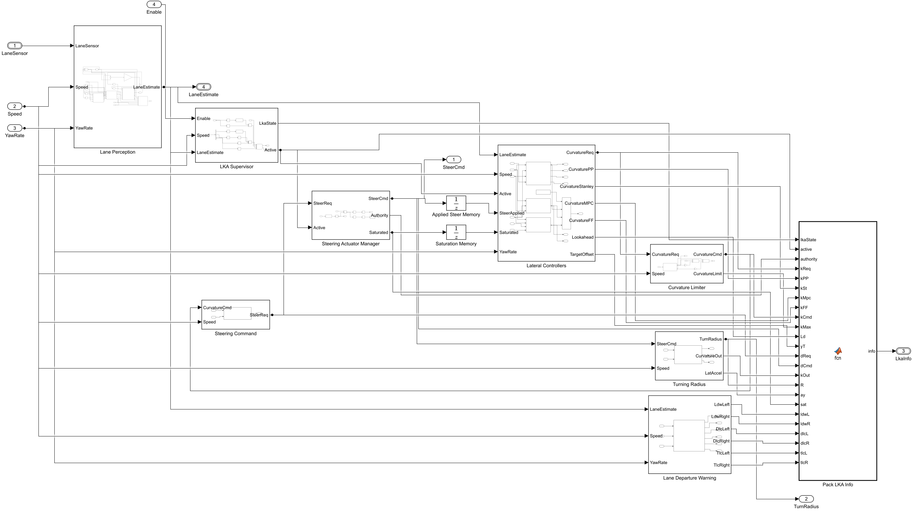 |
| Lane Perception | 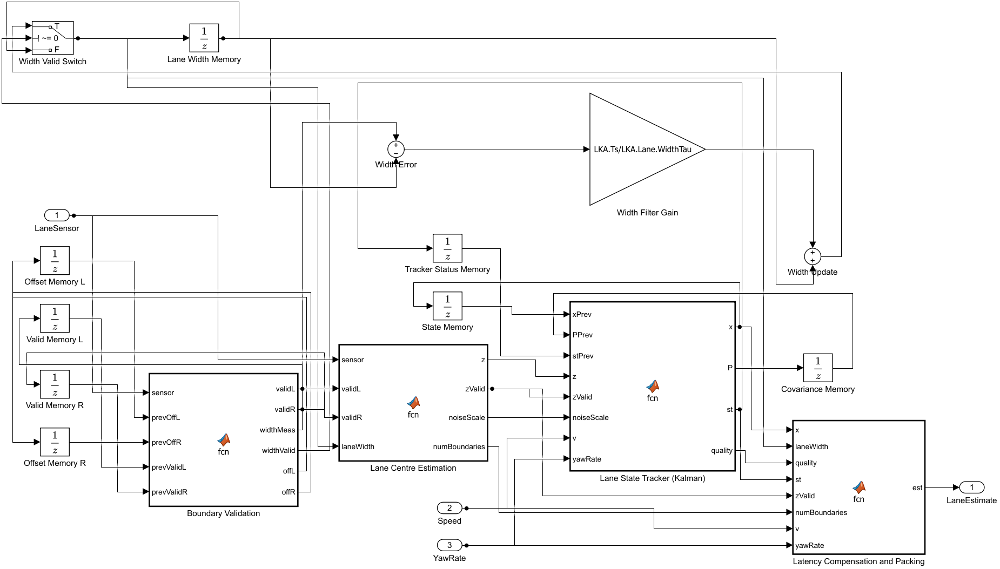 |
| Supervisor state machine | 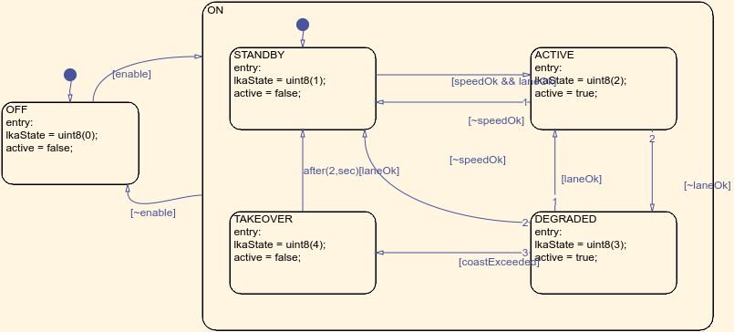 |
| Lateral controllers | 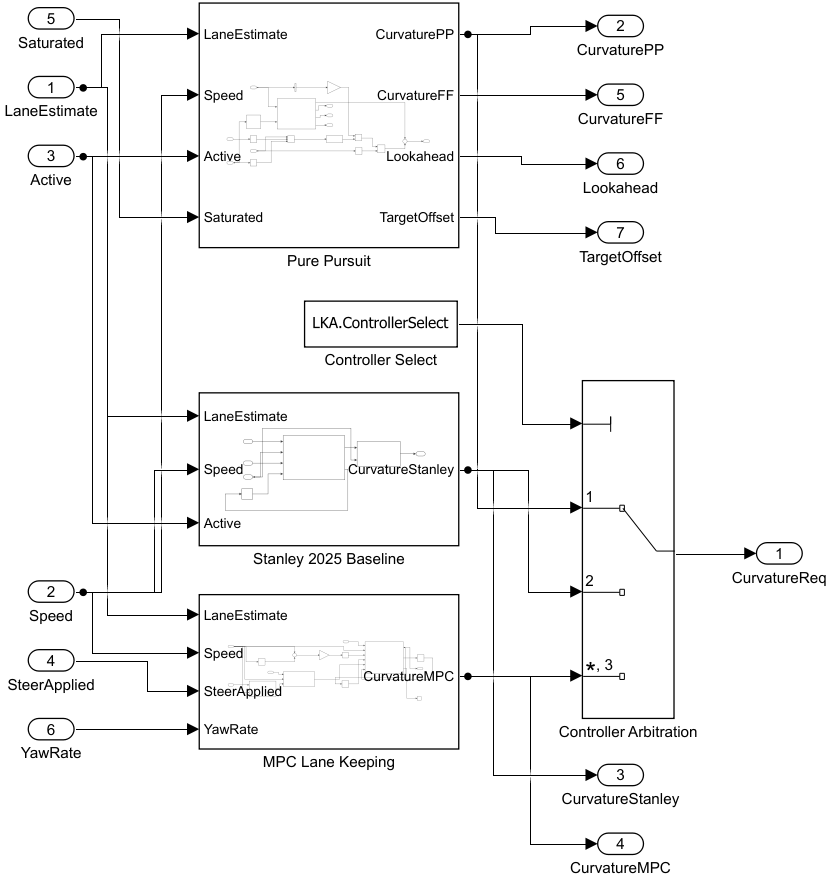 |
| Pure pursuit | 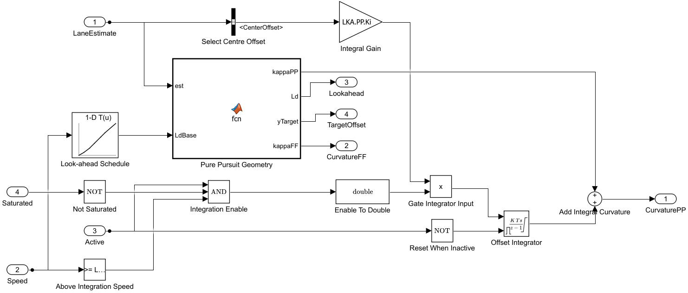 |
| MPC | 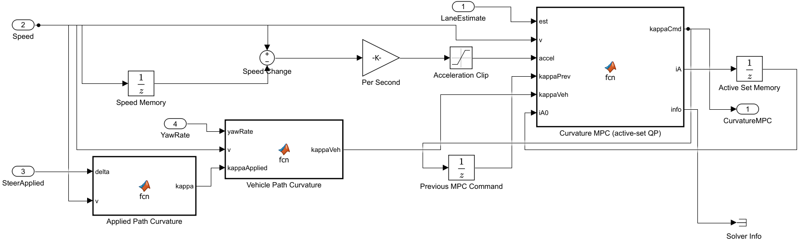 |
| Curvature limiter | 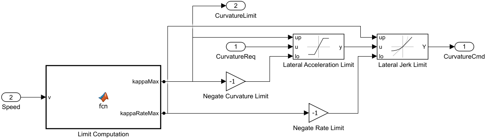 |
| Steering actuator manager | 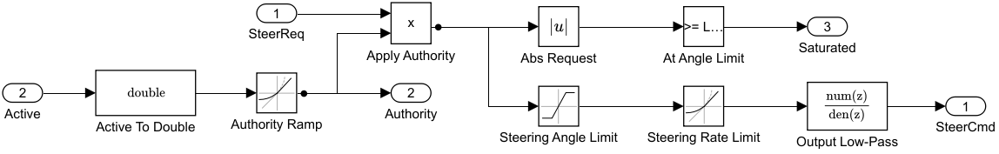 |
| Emulated lane detector | 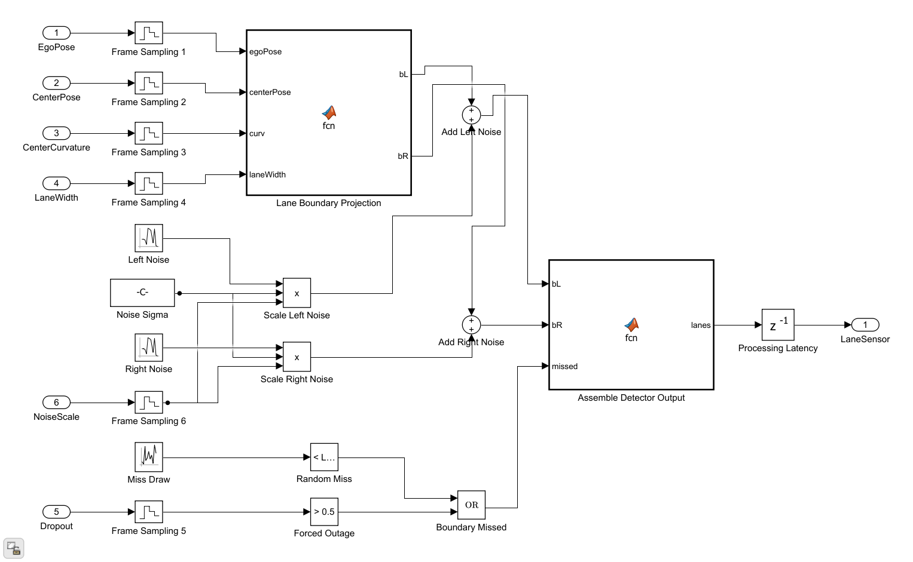 |
| MIL test bench | 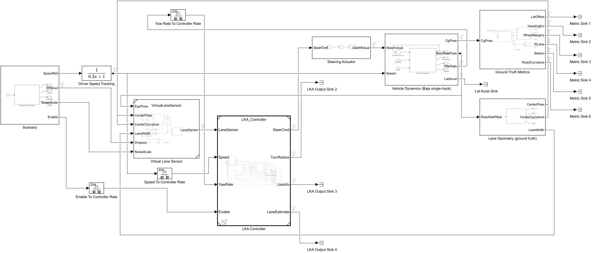 |
| Integration in aBaja2026.slx | 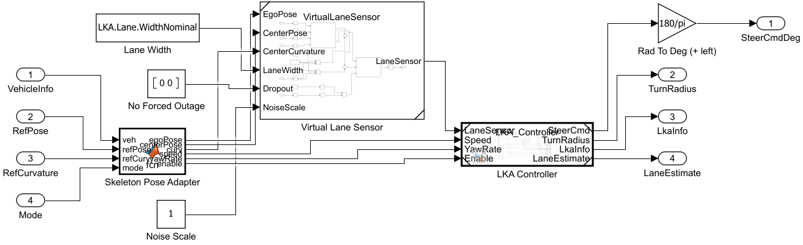 |

## 7. Known limitations and next steps

1. **RoadRunner co-simulation has not been run.** RoadRunner is not installed,
   and `aBaja2026.slx`'s `InitFcn` needs a live `rrSim`. The integration
   compiles cleanly with a substituted start pose. The first co-simulation run
   should check the sign of the skeleton pose and yaw (`LKA.Cosim.YawOffsetDeg`)
   and that the route runs along the lane centre.
2. **The lane detector is emulated.** Next, port the Asterix sliding-window
   detector to MATLAB on the skeleton's Simulation 3D Camera (1280×720,
   f = 1109 px) and fill `LaneSensorBus`. Nothing downstream changes.
3. **The emulated detector reports curvature at the vehicle position only.** It
   gives no preview of curves still ahead in the camera view. A real
   polynomial-fit detector would add preview, which helps pure pursuit and MPC
   at curve entries.
4. **The Baja parameters need confirming.** `vehicle_params.m` (L = 1.45 m,
   240 kg) differs from the 2025 CarMaker Baja (L = 1.341 m, about 347 kg).
5. **The MPC's QP solve is slower to simulate** than pure pursuit. A
   referenced-model rebuild takes about 60 s; after that, runs are fast.
